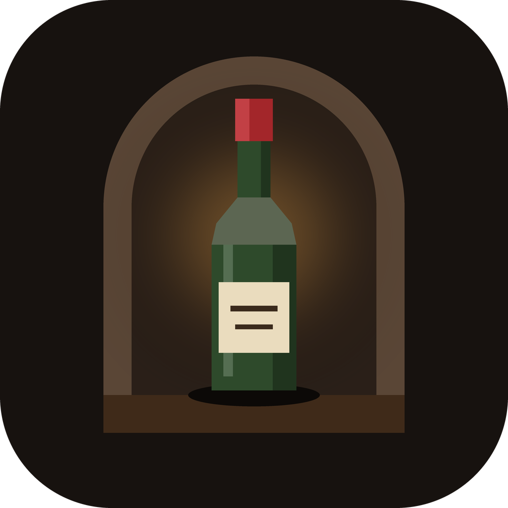
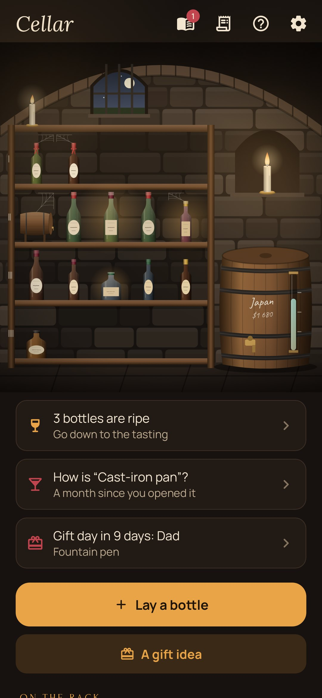
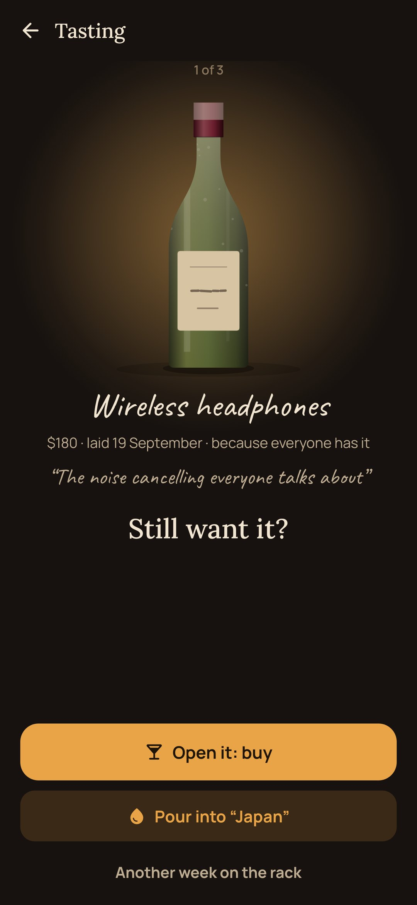
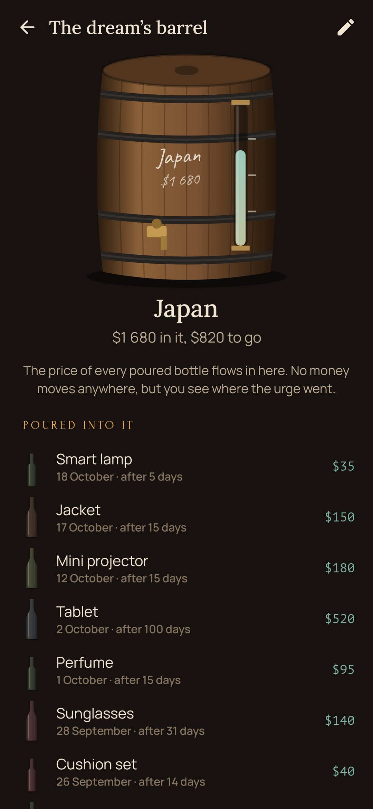
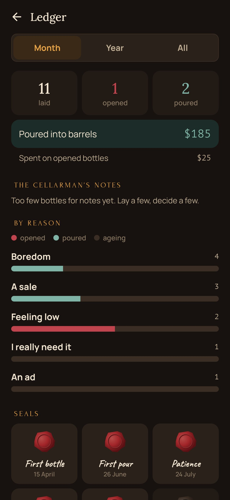
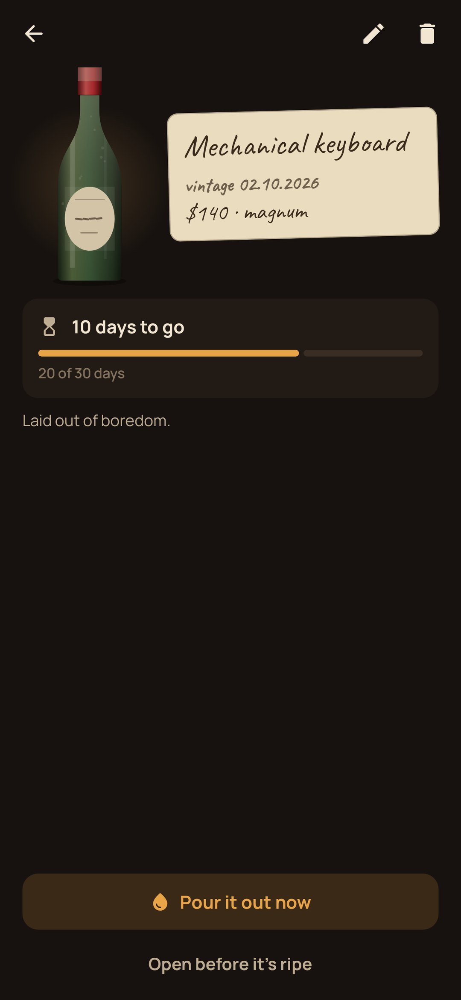

<div align="center">



# Cellar

### Let your wishes age.

*An impulse buy feels urgent for about a week. Cellar puts every wish to buy into a bottle and lays it down on the rack. When it's ripe you go down and taste it: if you still want it, open it, without a scrap of guilt. If it faded, pour it into the barrel of your real dream. Free, no ads, no account, no internet.*

[](https://github.com/bigdevwhale/cellar/actions/workflows/android.yml)
[](https://github.com/bigdevwhale/cellar/releases/latest)


[](LICENSE)

**English** · [Русский](README.ru.md) · [Changelog](CHANGELOG.md)

    

</div>

---

## The idea

Budget apps count what's already spent. Cellar stands between "I want it" and "I bought it", and asks for one thing only: time. A wish that is still alive a month later deserves to be bought. Most don't live that long, and the money they would have taken goes somewhere you actually care about.

## How it works

1. **Lay a bottle.** Type the wish in, or press "Share" in any shop's app and pick Cellar: the name, the link and sometimes the price come in by themselves. One honest question: why right now? Need, boredom, feeling low, an ad, "everyone has it", a sale.
2. **The price picks the bottle.** A vial ages three days, a bottle two weeks, a magnum a month, a cask three months (or choose your own). Both the prices and the ageing can be changed in the settings. On the rack, dust settles on the shoulders, a cobweb grows to the shelf above and the label yellows.
3. **The tasting.** Ripe bottles glow by candlelight and send one quiet notification. Take one in your hands: **open it** (the cork pops: buy it, no guilt), **pour it** (the bottle tips into the barrel), or give it **another week**.
4. **The dream's barrel.** Every poured bottle's price flows into the barrel with your real dream chalked on it: Japan, a safety cushion, a bicycle. A glass gauge shows the level; a full barrel is sealed with wax and an empty one rolled in.
5. **The sommelier's journal.** A month after opening, it asks how the purchase turned out: a fine vintage, so-so, or vinegar.
6. **The ledger.** By month, year or all time: what was laid, opened and poured, and the cellarman's notes on your reasons ("7 of the 9 bottles you poured were laid out of boredom", "a sale gives the most vinegar").
7. **Storms.** On 11.11, Black Friday to Cyber Monday, 12.12 and 6.18 there's a storm in the cellar window, and whatever is laid then ages twice as long.
8. **The gift shelf.** Ideas for presents wait with a ribbon round the neck, and the cellar tells you when someone's day is near.
9. **Seals** on the door for things that happened once: the first pour, patience, a bottle half a year on the rack, a full barrel.

## Privacy

No account, no ads, no analytics, no internet permission. Nothing is connected to a bank: only what you bring down yourself. Links open in your browser; pictures are copied into the app's private files.

## Building

```bash
./gradlew testDebugUnitTest assembleDebug              # app.cellar.dev, next to a real install
./gradlew assembleDebug -Pdemo                         # app.cellar.demo with a cellar half a year in
./gradlew testDebugUnitTest -Prender --tests '*RenderArt*' && python tools/shots.py   # screenshots
python tools/icon.py                                   # the logo
python tools/res.py                                    # theme, the launcher and notification icons
```

Kotlin, Jetpack Compose, Room, DataStore, WorkManager. Everything is drawn in code: the vaulted cellar with its barred window and storm, candles, the oak rack, four kinds of bottles (each with its own glass, capsule and label from a seed number), dust, cobwebs and the barrel with its gauge.

## License

[MIT](LICENSE). Fonts: Lora, Forum, Manrope, Caveat and PT Mono, all under the SIL Open Font License.
