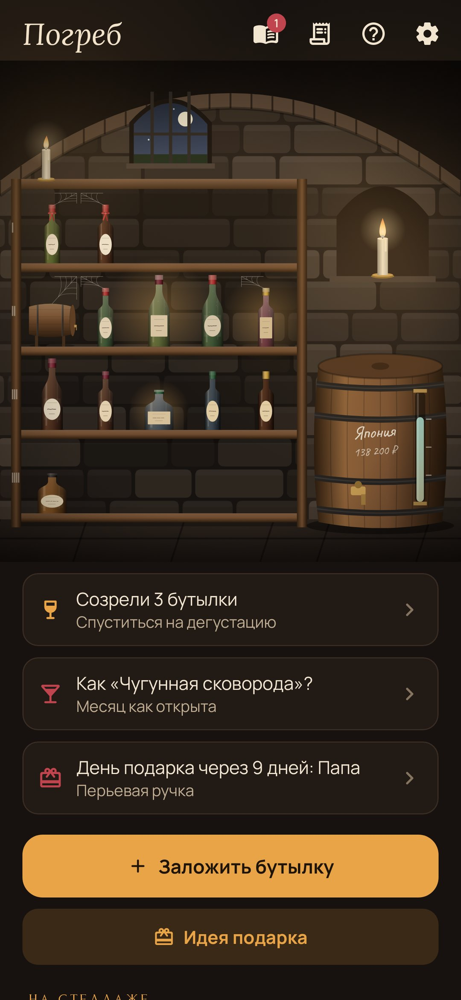
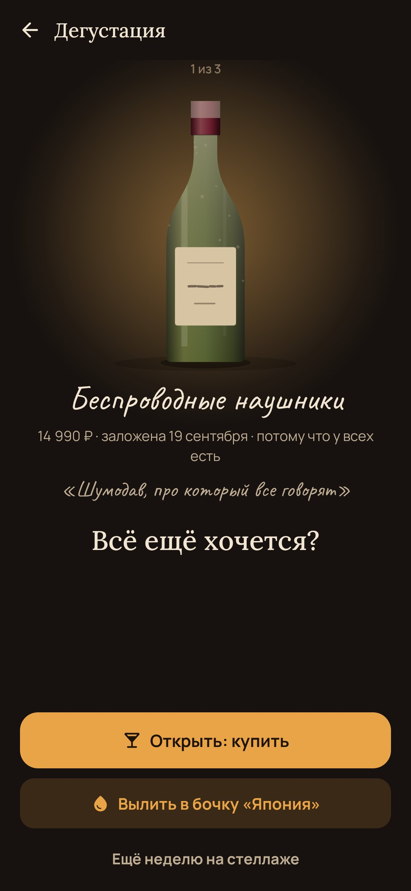
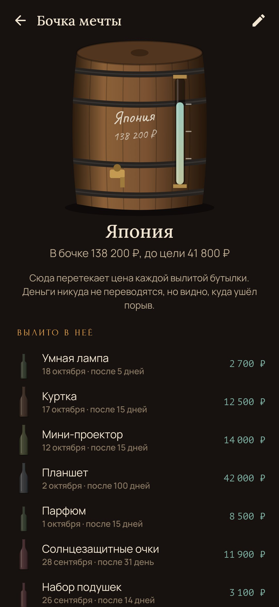
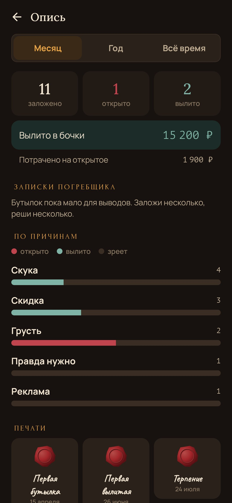
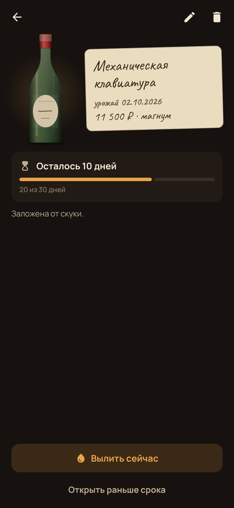

<div align="center">


# Погреб

### Пусть желания выдержатся.

*Импульсивная покупка кажется срочной примерно неделю. «Погреб» кладёт каждое желание купить в бутылку и ставит её на стеллаж. Когда она созреет, ты спускаешься на дегустацию: если всё ещё хочется, открываешь без капли вины. Если выдохлось, выливаешь в бочку своей настоящей мечты. Бесплатно, без рекламы, аккаунта и интернета.*

[](https://github.com/bigdevwhale/cellar/actions/workflows/android.yml)
[](https://github.com/bigdevwhale/cellar/releases/latest)


[](LICENSE)

[English](README.md) · **Русский** · [История изменений](CHANGELOG.md)

    

</div>

---

## Идея

Бюджетные приложения считают то, что уже потрачено. «Погреб» встаёт между «хочу» и «купил» и просит только одного: времени. Желание, которое живо и через месяц, заслуживает покупки. Большинство столько не живут, и деньги, которые они бы забрали, уходят туда, где они правда важны.

## Как это работает

1. **Заложить бутылку.** Впиши желание сам или нажми «Поделиться» в приложении любого магазина и выбери «Погреб»: название, ссылка, а иногда и цена подставятся сами. Один честный вопрос: почему хочется именно сейчас? Правда нужно, скука, грусть, реклама, «у всех есть», скидка.
2. **Цена выбирает бутылку.** Флакон выдерживается три дня, бутылка две недели, магнум месяц, бочонок три месяца (или выбери свой срок). И цены, и сроки можно поменять в настройках. На стеллаже на плечики оседает пыль, к полке тянется паутина, желтеет этикетка.
3. **Дегустация.** Созревшие бутылки светятся в свете свечей и присылают одно тихое уведомление. Возьми бутылку в руки: **открыть** (хлопает пробка: покупай, без вины), **вылить** (бутылка наклоняется над бочкой) или **ещё неделю** на стеллаже.
4. **Бочка мечты.** Цена каждой вылитой бутылки перетекает в бочку с твоей настоящей мечтой, написанной мелом: Япония, подушка безопасности, велосипед. Уровень видно в стеклянной трубке. Полную бочку запечатывают сургучом и вкатывают пустую.
5. **Журнал сомелье.** Через месяц после открытия он спрашивает, как оказалась покупка: удачный винтаж, так себе или уксус.
6. **Опись.** За месяц, год или всё время: что заложено, открыто и вылито, и записки погребщика о твоих причинах («7 из 9 вылитых бутылок были заложены от скуки», «больше всего уксуса даёт скидка»).
7. **Грозы.** На 11.11, с «чёрной пятницы» по «киберпонедельник», на 12.12 и 6.18 в окошке погреба гроза, и всё, что заложено в эти дни, выдерживается вдвое дольше.
8. **Полка подарков.** Идеи подарков ждут с ленточкой на горлышке, а погреб напомнит, когда чей-то день близко.
9. **Печати** на двери за то, что случилось однажды: первая вылитая, терпение, бутылка полгода на стеллаже, полная бочка.

## Приватность

Без аккаунта, рекламы, аналитики и разрешения на интернет. Никаких банков: только то, что ты сам принёс в погреб. Ссылки открываются в браузере, картинки копируются в личные файлы приложения.

## Сборка

```bash
./gradlew testDebugUnitTest assembleDebug              # app.cellar.dev рядом с настоящей установкой
./gradlew assembleDebug -Pdemo                         # app.cellar.demo с погребом за полгода
./gradlew testDebugUnitTest -Prender --tests '*RenderArt*' && python tools/shots.py   # скриншоты
python tools/icon.py                                   # логотип
python tools/res.py                                    # тема, иконка приложения и уведомления
```

Kotlin, Jetpack Compose, Room, DataStore, WorkManager. Всё нарисовано кодом: сводчатый погреб с зарешёченным окошком и грозой, свечи, дубовый стеллаж, четыре вида бутылок (стекло, капсула и этикетка у каждой из своего числа), пыль, паутина и бочка с трубкой уровня.

## Лицензия

[MIT](LICENSE). Шрифты Lora, Forum, Manrope, Caveat и PT Mono распространяются под SIL Open Font License.
